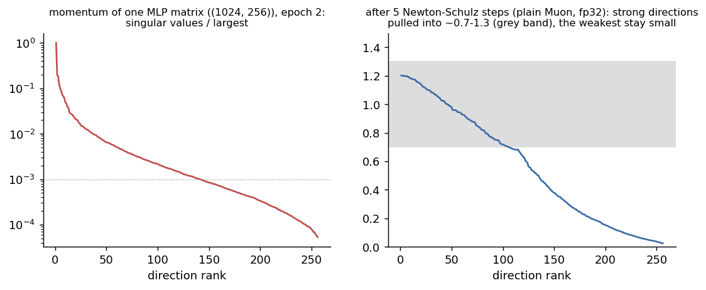
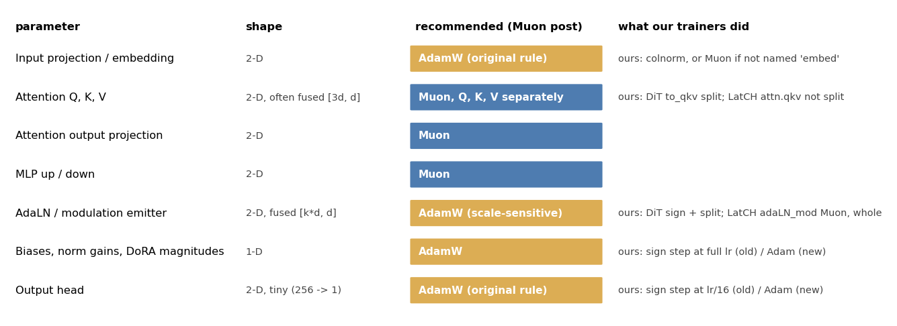
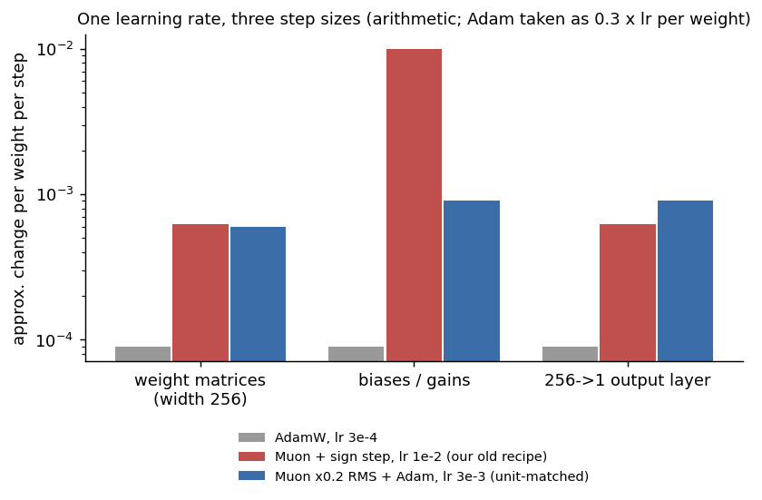
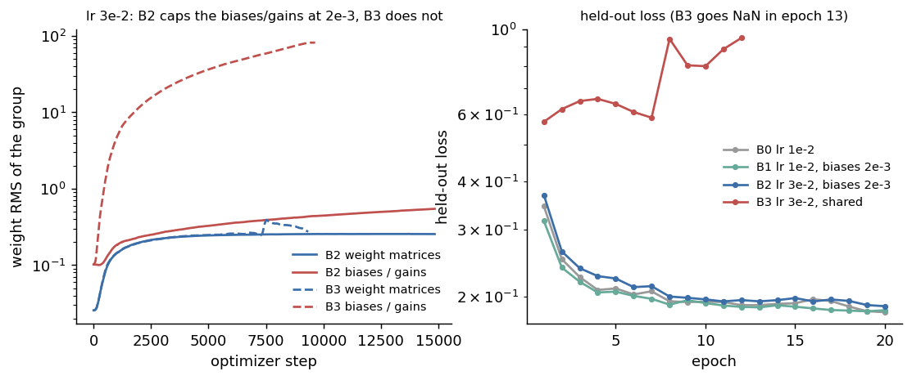
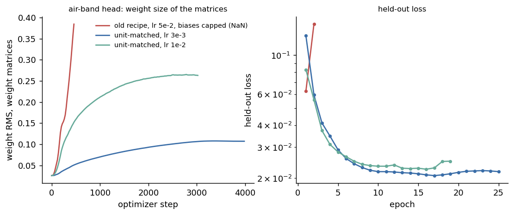
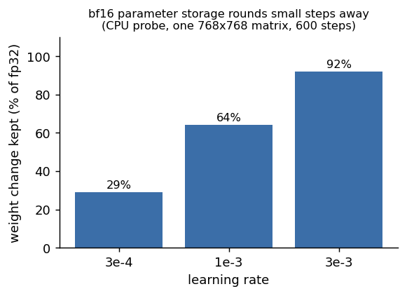

<!-- DRAFT 2026-10-21, round 2 (WINTERMUTE). Restructured as "Muon and derivatives: a DIY survival guide" on the project
call of 2026-10-21 (neutral, paper-like tone; answer "coming from AdamW/Prodigy LoRAs, what changes with Muon"; a section on
every optimizer change we tried; routing diagrams; graphs and audio).
Inputs: CONTINUITY (original Muon post + Moonlight read from the PDF; own results from its journal), THE-FINN
(docs/optimizer-experiment-catalog-2026-10-21.md, a sweep of all logs; round-1 fact audit), GHOST-NOTE (hands-on results;
audio picks). Round-1 reviews (CONTINUITY theory, THE-FINN facts, GHOST-NOTE practicals) are carried into the text; their
notes are in git history (commits 1edb35a, e4983ed, ce598f6, 126cb14).
Figures: Misc/build_muon_guide_figures.py -> blog/assets/muon-survival-guide/ (every curve from a run log or optimizer
state; the step-size chart and the bf16 bars are labelled arithmetic / CPU probe).
Open before publishing:
  1. Audio: GHOST-NOTE picked and RMS-matched the four clips (provenance internal); WINTERMUTE stripped their metadata into
     blog/assets/. Nobody has listened to the selected excerpts yet; the picks rest on recorded verdicts.
  2. Section 6 (batch): the sweep runs from 13:34 (lr 1e-3); "pending" until then.
  3. Done 13:40: AIR_U10, ON_U1 and ON_U3 are in section 4, the section 8 row and section 11.
  4. Final review round on this version.
No checkpoint names, paths, infrastructure or names of people below; arm labels (B2, B3) are how the results are filed. -->

# Muon and derivatives: a DIY survival guide

This guide is for people who have trained LoRAs or fine-tunes with AdamW or Prodigy and are now trying Muon or one of
its variants. It lists what changes when you switch, the mistakes we made and how we detected them, and the result of
every optimizer change we tried between May and October 2026. Most of our evidence comes from small jobs on one 16 GB
GPU, so we say where it is thin.

## Summary

- Muon only replaces the optimizer for 2-D weight matrices. Everything else still needs a second optimizer, and how the
  two are set up relative to each other caused most of our failures.
- A Muon learning rate and an AdamW learning rate are in different units. Without a rescale, the same number moves
  different parameter groups by amounts that differ by a factor of 16 or more.
- Muon sets the step size from the learning rate, not from the gradient. Weights can grow every step while the loss
  looks normal, so weight decay and logging of weight size per group are needed.
- At small batch sizes the gradient is noisy, and several add-ons designed for large-batch training behaved differently
  for us or had no measurable effect.
- When fine-tuning a model that was pre-trained with Adam, two papers report that Muon brings no clear advantage for full
  fine-tuning; LoRA reduces the difference.

## 1. What we trained

| Job | Size | Data | Batch | Notes |
|---|---|---|---|---|
| Control heads, from scratch | 5-10 M parameters, width 256-512 | 5,401 or 12,524 crops of music latents | 16-32 | most of the controlled comparisons |
| LoRA / DoRA on Stable Audio 3 | rank 128-256 adapters | a few hundred to about 12,000 tracks or crops | 1-16 | listening tests, long runs |
| Full fine-tunes of Stable Audio 3 | the whole diffusion model | a few hundred to about 12,000 tracks or crops | 1-8 | few runs, several failures |

Almost every comparison below is a single run per setting. Repeating one head recipe gave held-out losses that differed
by about 0.004, so we treat smaller differences as noise.

## 2. What Muon computes

AdamW updates each weight using that weight's own gradient history. Muon works on whole matrices. For each 2-D weight
matrix it keeps a momentum (a running average of recent gradients), and replaces it with an approximately orthogonal
matrix by running five Newton-Schulz iterations, a fixed polynomial with coefficients (3.4445, -4.7750, 2.0315). In
plain terms: the gradient still decides in which directions the matrix changes, and the directions the iteration
reaches are given steps of similar size, however strong or weak the gradient was along them. The method was introduced in [Keller Jordan's Muon post](https://kellerjordan.github.io/posts/muon/)
(December 2024), with results on CIFAR-10 and GPT-2-sized language models.

Two details matter in practice. The result is only approximately orthogonal: the coefficients are chosen to put the
singular values in roughly 0.7 to 1.3, and the post reports that this error does not hurt. And directions far weaker
than the strongest one are not pulled up within five steps. The figure shows this on a real momentum matrix from one
of our heads at batch 16.

The original post also states, as open questions, whether Muon helps for fine-tuning at all. Two later papers address
this (section 7).

## 3. Which parameters go where

Muon is only defined for 2-D matrices, and the original post recommends it only for the hidden layers. Everything
else goes to a second optimizer, usually AdamW:

- embeddings (and, in our reading, other input projections);
- the final output layer (classifier head), even though it is 2-D; the post says this rule came from experiments;
- 1-D parameters: biases, normalisation gains, DoRA magnitude vectors;
- scalars.

Attention projections that are stored as one fused matrix (Q, K and V together, shape [3d, d]) should be split, so that
each of Q, K and V is orthogonalised on its own; the Muon post reports that this works better (an experiment it credits to
Vlado Boza). Fused modulation layers (AdaLN), which produce several scale and shift vectors from one matrix, are the same
situation; splitting those is our reasoning, not a tested result.

Trainers decide this from parameter names and shapes, and the rules can miss. Ours did:

In our small heads the fused attention matrix was not split (the rule looked for a different name), the AdaLN emitter
was treated as an ordinary hidden matrix, and the time-embedding layers were treated as embeddings. We do not know the
effect yet; changing the routing is a new experiment, not a silent fix. **Check what your trainer does:** print the
parameter groups at start-up and read the list.

## 4. Learning-rate units

This is the main difference from AdamW, and it caused most of our failures.

An AdamW step moves each weight by about 0.2 to 0.4 times the learning rate ([Moonlight](https://arxiv.org/abs/2502.16982)
measured this). The orthogonalised Muon update for an m x n matrix has a size per weight of about 1/sqrt(max(m, n)) times
the learning rate (Moonlight's Lemma 1): 1/16 of the learning rate for a square or tall 256-wide matrix. The original Muon
code multiplies by sqrt(max(1, rows/cols)), which changes this for tall matrices, and in our own optimizer a row
normalisation step gives wide matrices, including LoRA A, a step 2 to 3.6 times larger. In our optimizer the 1-D
parameters were moved by a sign step, which moves each of them by the full learning rate. One learning rate therefore
produced three different step sizes:

In numbers, per weight and per step: AdamW at its best setting for these heads (lr 3e-4) moves each weight by about
0.6e-4 to 1.2e-4. Our Muon recipe at its best setting (lr 1e-2) moved the 256-wide matrices by about 6e-4, 5 to 10 times
more than AdamW, and the biases and gains by 1e-2, 80 to 170 times more. So the learning-rate gap between the two
optimizers (about 30x) is only partly a change of units: the matrices really took larger steps, and the biases and gains
far larger ones.

**What happened.** We trained the same head at lr 3e-2 twice. In run B2 the biases and gains had their own learning
rate of 2e-3; in run B3 they used the shared 3e-2.

B2 trained (held-out loss 0.189, against 0.182 for the same head at lr 1e-2, so the higher rate did not help). B3 did
not learn: its held-out loss stayed between 0.57 and 0.95 and became NaN in epoch 13. The biases and gains reached about
170 times the size B2's had at the same step. With the learning rate lowered to 3e-4 to protect the biases, the head
learned too slowly, because the matrices and the small output layer then moved only about 2e-5 per weight per step.

**The fix in the literature.** Moonlight scales the Muon update by 0.2 x sqrt(max(m, n)) so that every matrix moves
about 0.2 times the learning rate per weight, the size of an AdamW step. The non-matrix parameters stay on AdamW with
the same learning rate and weight decay. [SF-NorMuon](https://arxiv.org/abs/2605.23061) uses the same rule. After this
rescale, the papers use AdamW-style learning rates for both groups (in language-model pre-training). Some implementations
already include it; check yours. Our heads still wanted larger steps than that: the best rescaled setting we have found
so far is lr 3e-3, about 10 times AdamW's best lr, which is about 5 to 10 times AdamW's per-weight step.

**Our first test of it.** On a small head that had diverged at every learning rate above 1e-2 we tried, the rescaled
recipe at lr 3e-3 trained for all 25 epochs and reached the same held-out loss as the old recipe at its best setting
(0.0207 against 0.0206). This is an equal-step comparison: 0.2 x 3e-3 moves the matrices as far per step as 1e-2 / 16
did. It shows that the conversion works, not that the usable range is wider.

**The range test.** We then ran the same recipe at lr 1e-2, which moves the matrices as far per step as the old recipe at
lr 3e-2. At that step size the old recipe became NaN on this head twice, in epochs 15 and 26. The rescaled run did not
diverge: the weight size of the matrices levelled off at about 0.26 (0.11 at lr 3e-3), and no learning-rate cut was
needed. Its best held-out loss, 0.0225, was worse than the 0.0207 at lr 3e-3, and the loss rose from epoch 17, so the stop
rule (section 5) ended the run after epoch 19. Two limits: the old runs used a batch of 64 and this one 32, and the
rescaled recipe changes two things at once (the matrix scale and AdamW for the biases and gains), so we cannot say which
of the two prevents the divergence. What we can say: a learning rate 3 times too high now costs some loss instead of the
run.

**On a second head** (the onset head of section 1) the rescaled recipe at lr 1e-3 reached 0.1798 and was still improving
at epoch 20; at lr 3e-3 it reached 0.1829 at epoch 14 and then drifted up. The old recipe's best on this head was 0.1822.
These three differ by less than we would expect from changing the random seed. The best rate differed between the two
heads (3e-3 for the air head, 1e-3 for the onset head), so we would start a new job at 1e-3 and try 3e-3.

## 5. Weight size, weight decay, and how to see a run going wrong

Muon's step size does not shrink when the gradient gets small. A matrix can grow every step while the loss looks
normal. In each of the failures below, the weights grew before the loss showed a problem:

- B3 above: biases and gains grew about 170-fold over B2's at the same step before the loss became NaN.
- A small head at lr 5e-2 with a separate rate for the biases: its matrices grew 15-fold in 460 steps, then NaN. Here
  the matrices themselves stepped too far.
- Full fine-tunes of Stable Audio 3 without weight decay: the latents the model produced grew from a standard deviation
  of about 0.7 to 1.3 by epoch 3 and 5.6 by epoch 7 (a healthy model is near 1.1). The audible result was a drone under
  the music. The optimizer's default weight decay was zero and our full fine-tune path never set it. AdamW runs with decay
  0.01 on the same data stayed healthy.

Two clips from one sweep of full fine-tunes, same prompt, seed, guidance scale and epoch (7). In the first run the
generated latents sat at a standard deviation of about 3.0 (healthy is about 1.0 to 1.15): a distorted drone at every
guidance scale. In the second they stayed at 0.59; by ear it is clean, though a listener described this arm as
disjointed. Both use the runs' EMA weights, which at that point were still more than half the starting model. The cause
of the first run's growth is only partly established.

Moonlight reports the same effect at large scale: without weight decay, the weights and layer outputs grew past the range
bf16 represents well, and the advantage over AdamW shrank. [Muon-SW](https://arxiv.org/abs/2607.23777) reports that with a
constant weight decay Muon's weight norm shrinks steadily over training, and scales the decay with the learning rate so
that the norm settles. (Under Schedule-Free, where the learning rate does not decay, that scaling has no effect.) [Hyperball](https://arxiv.org/abs/2606.16899) fixes the norm outright; we found it is not a
drop-in for adapters, because a matrix that starts at zero has norm zero and does not move. Background on why weight
decay sets the effective step size: [Rotational Equilibrium](https://arxiv.org/abs/2305.17212) and
[Weight Decay may matter more than muP](https://arxiv.org/abs/2510.19093).

**What to log.** In order of how often each one warned us first:

1. The RMS of the weights in each parameter group, every few hundred steps. A group that doubles within an epoch after
   warmup needs attention. Our head trainer can halve that group's learning rate automatically; the option is new and off
   by default.
2. The RMS of the update in each group, and the ratio update / weight. A ratio that stays far above the other groups is
   the group that will run away.
3. Loss as a median plus a count of spikes, not as a mean. In one full fine-tune the mean of each logging bin fell from
   405 to 84 and looked like convergence, while the median stayed at 2.5 against 0.79 for the reference run and 38% of
   steps spiked above 5. Gradient clipping at 1.0 did not change that.
4. For generative models, the size of what the model produces. For us that is the standard deviation of the generated
   latents; values from 1.3 up were the early stage of the drone above.
5. Finite checks on the saved weights and on test outputs, both. In one LoRA run, test renders had latents up to 10^10
   that a clamp in the demo code hid, while every saved tensor was finite. Neither check alone would have caught it.
6. The path of the weights over the run: the distance from the start, the speed per step, and the path efficiency (the
   straight-line distance divided by the length of the path). In our DoRA full-rank runaways the layers moved in lockstep. Path efficiency
   alone does not separate healthy from runaway runs: the DoRA runaways read 0.14 to 0.23, but one run that converged read 0.216.
   The global norm (99-114 healthy against 4,085-12,189) and the speed per step did separate them.

**Stops.** Our head trainer now stops at the first non-finite loss, and when the held-out loss stays above 1.5 times its
best for two epochs, or rises three epochs in a row and is more than 5% above its best. Replayed on our recorded runs,
the second rule would have stopped B3 at epoch 4 instead of 13 and left the healthy runs alone.

**Check that each mechanism is active.** We audited one optimizer and found that three of its mechanisms (escape
velocity, a variance-damping tier, and Schedule-Free averaging when its burn-in was longer than the run) had no effect on
the step, and that its NaN guard could not detect NaN (a comparison with NaN is always false). Results from runs where a
mechanism was inactive say nothing about that mechanism. Log a counter or a value that shows each one changes the step.

## 6. Batch size, dataset size and gradient noise

A gradient from a small batch is the true direction plus noise. With batches of 1 to 16, as on most consumer GPUs, the
noise is large relative to the signal. Momentum averages over the last 10 to 20 steps and removes much of it. Anything
that looks at the difference between two consecutive gradients, or at a per-element signal-to-noise ratio, mostly
measures noise at these batch sizes (section 8).

Muon adds a specific problem: because weak directions get steps comparable to strong ones (within the limits shown in
section 2), noise directions in the momentum also get a real step. The [SAMuon paper](https://arxiv.org/abs/2608.25990)
reports that its improvement over Muon grows with batch size. [A paper on noise scales for sign and spectral descent](https://arxiv.org/abs/2602.03001)
gives the matching way to measure the noise and choose a batch size (the classic version for SGD is
[McCandlish et al.](https://arxiv.org/abs/1812.06162)). Our first attempt to measure it, by comparing the two halves of
each batch of 16, could not separate signal from noise.

For AdamW the picture can be different. In one comparison, AdamW at an effective batch of 8 (by accumulation) behaved the
same as at batch 1 in every statistic we logged.

Two practical points on batch size:

- **Gradient accumulation gives a larger effective batch without more memory.** Our heads are compute-bound on the GPU,
  so an epoch takes the same time at any effective batch. A larger batch takes fewer, less noisy steps over the same data.
- **Compare batch sizes at equal steps, or say you did not.** In one of our sweeps the batch-32 run had half as many
  steps as the batch-16 run in the same number of epochs, and the batch-8 run twice as many. Its result that "batch 8 is
  as good as 16" came from the extra steps; at equal steps batch 8 was worse.

We are now training the same head at effective batches of 64, 128 and 256 for the same number of epochs, and measuring
the noise from the two halves of each accumulated batch. **Result pending; this section will be updated.**

On dataset size: our heads trained on 5,401 and on 12,524 crops gave the same ranking of the Muon-type optimizer against
AdamW. On the larger set every curve was still falling at 10 epochs, so a short run ranks learning speed, not final
quality. In one sweep the
setting that finished best led only from epoch 8 of 10; clear failures were visible by epoch 2 or 3.

## 7. Fine-tuning a model pre-trained with Adam

Moonlight reports that the advantage of Muon holds when both pre-training and fine-tuning use Muon. When they differ,
fine-tuning with Muon showed no significant advantage over AdamW; on an Adam-pre-trained 7 B model the two were on par.
[Can Muon Fine-tune Adam-Pretrained Models?](https://arxiv.org/abs/2605.10468) studies this in detail:

- Fine-tuning with the other optimizer than the one used for pre-training is more sensitive to the learning rate and
  forgets more.
- In full fine-tuning on math and code, Muon moved the weights 5.6 to 7.4 times further from the pre-trained ones than
  Adam did. With LoRA this reverses (0.2 to 0.8 times as far).
- LoRA reduced the gap by 78% for Adam-pre-trained models. In the case with the largest mismatch, LoRA with Muon beat
  LoRA with Adam at low and moderate ranks and became worse at high ranks.
- The paper uses cosine decay with 3% warmup throughout; it does not use a constant learning rate. Its Muon is the
  Moonlight variant, so its learning rates are in AdamW-like units.

Which optimizer pre-trained Stable Audio 3 is not stated in its report. Its post-training stage used Muon at lr 1e-5 on
the attention and feed-forward matrices and AdamW at lr 1e-6 on the rest, with a decaying schedule
([Stable Audio 3 report](https://arxiv.org/abs/2605.17991)). Do not copy a learning rate from a from-scratch setup to a
fine-tune.

Two observations from our own LoRA and DoRA runs:

- **LoRA A barely moves.** In one run, 99.2% of the space spanned by the rows of A was unchanged between steps 240 and
  1,440, against 35% for the corresponding space of B. (We also counted A's share of the update, about 7%, but with every
  row normalised that share mostly reflects A's row count, so it is not evidence.) We have no AdamW control for this; an
  imbalance between A and B is also known for AdamW ([LoRA+](https://arxiv.org/abs/2402.12354)), though the mechanism
  there differs, so do not read it as specific to Muon. A larger learning rate for A (20 times)
  rotated it, but also made the adapter 2.3 times larger and produced one NaN render, so the result is not clean.
- **DoRA magnitudes can cross zero.** DoRA's per-row magnitude parameters started between 0.13 and 0.45. A fixed-size
  step (sign descent) moved 592 of them to zero or below by step 6,340, and the run became NaN near step 6,900. A
  multiplicative update of the magnitudes fixed it. AdamW's steps are smaller (0.2 to 0.4 x lr) and their sign is noisy,
  so a crossing is slower there, but moving small positive scalars to AdamW does not by itself guarantee they stay
  positive.

## 8. Every optimizer change we tried

Results are single runs unless stated; differences under 0.004 on the heads are noise. "Head" means the from-scratch
control heads of section 1.

| Change | What it does | What we found |
|---|---|---|
| Muon-type optimizer vs AdamW (heads) | orthogonalised matrix updates, with Schedule-Free | 0.357 against 0.408 at 10 epochs on 5,401 crops; best lr about 30x AdamW's |
| Schedule-Free averaging | evaluates and saves an average of the weights instead of decaying the lr | the largest single effect: 0.20-0.21 with, 0.255 without, AdamW 0.25-0.26 (12,524 crops). Its burn-in and averaging weight (sf_r) moved results by 0.0005 to 0.006 against a noise of about 0.004 |
| Shampoo / Mousse preconditioner | rescales the gradient by its curvature before Newton-Schulz | no measurable gain on heads; it was on in all our head runs by default |
| SOAP | a different curvature preconditioner | 0.0212 against 0.0206 on one head, slower; ran out of memory in our FiLM-adapter test |
| Full Fusion stack (Newton-Schulz, MONA, KL-Shampoo, Schedule-Free) | our earlier combined optimizer | 12-20% lower error than AdamW at equal wall time on the older heads; MONA and KL-Shampoo on top added about 1% for 50% more time |
| MONA | adds a term from the difference between consecutive gradients | worse than AdamW in one comparison; crashed at high lr on another head. At small batch that difference is mostly noise; not a clean test |
| NorMuon | normalises each row of the update | in our version it cancels the shape-based radius exactly; on wide matrices our variant steps 2-3.6x larger than the reference implementation. No outcome test yet |
| Separate lr for biases and gains | 1-D parameters on their own lr | B2 vs B3 (section 4): trains at lr 3e-2 where the shared lr does not; at lr 1e-2 no difference (0.1832 vs 0.1822) |
| Update rescaled to AdamW size + AdamW for 1-D | Moonlight / SF-NorMuon rule | two heads: same loss as the old best setting; at 3x the step size where the old recipe became NaN, it trained (somewhat worse loss, weights level) |
| Radial brake, escape velocity, burn-in | limit weight-norm growth; grow the step over time; delay averaging | all within 0.001-0.006 of the plain recipe, i.e. inside the noise. Escape velocity was inactive in early runs and later raised the step from 1.0 to 1.6x while a run was diverging |
| Variance damping (VADD) | lowers the step when the loss variance is high | applied its factor twice when it fired (a bug, fixed); in an ablation, removing it did not change the adapter's size |
| Signal-to-noise gate | scales each element by its estimated signal-to-noise ratio | sat at its own noise floor (0.18-0.21), so it acted as a fixed cut of the lr to about 0.2x. Removing it from a DoRA run made the adapter 4.4x larger in 1,011 steps |
| Gradient clipping at 1.0 | caps the gradient norm | did not prevent any of four divergences at lr 3e-2 to 1e-1, and did not reduce loss spikes in a full fine-tune. Under Muon the step size comes from the lr, so clipping the gradient changes little |
| AdaGC | per-tensor adaptive clipping | at a tight setting it clipped 68% of steps and bent the adapter's path; at a loose setting about neutral |
| Cautious masking | drops update elements whose sign disagrees with the gradient | after Newton-Schulz about half the elements disagree at random, so the mask removes a random half. The rescale of the survivors increased the update by 37% and one DoRA run became NaN; fixed |
| D-Adaptation / automatic step size | estimates the lr during training | three of four DoRA rank-128 runs ran away (global norm 10-17x its healthy value); the run without it stayed healthy for 22,000 steps |
| Prodigy | automatic lr for AdamW | not tested standalone with Muon; a Prodigy-style step growth inside our optimizer trained a 13,500-step run without problems. On our older (pre-Muon) heads Prodigy was about 3% better than AdamW (0.1486 vs 0.1534) at 35% more time |
| Lion | sign of the momentum, fixed step | 0.228-0.262 against about 0.20 on heads, the best Lion setting was the lowest lr tried; outputs sound fine but stylistically different from AdamW |
| Cosine decay / damping schedules | lower the lr over the run | cosine cut the update size 10x and made late steps more consistent; it did not prevent divergence at lr 5e-2. On the older AdamW heads cosine helped a too-high lr and hurt a good one. A 16-run comparison of WSD vs our braked optimizer on LoRA and DoRA was trained but not analysed |
| Weight decay scaled with training length | decay grows with the square root of the epoch count | the weight norm grew sub-linearly over 13,500 steps, as predicted |
| Weight decay of zero | default in our full fine-tune path | drone from weight growth (section 5) |
| Multiplicative DoRA magnitude update | scales magnitudes instead of adding to them | fixed the zero-crossing (section 7) |
| Larger lr for LoRA A (x20) | compensates for A barely moving | rotated A, adapter 2.3x larger, one NaN render; confounded |
| LoRA-TSD | Muon-style steps on the LoRA manifold | implemented, never trained |
| Hyperball | fixes the norm of weights and updates | not usable on zero-initialised adapters; a full fine-tune run was trained, result not analysed |
| EMA of the weights | smoothed copy for evaluation | helped one head (3x the control effect). An EMA that has not converged can still be mostly the starting weights; one such copy rendered non-finite output |
| fp32 optimizer state | keep momentum and averages in fp32 | in a CPU test bf16 kept 29%/64%/92% of the weight change at lr 3e-4/1e-3/3e-3; in a FiLM adapter the K/V matrices moved 7x further with fp32 state, at equal loss; 13-21 ms per step |
| bf16 Newton-Schulz | run the orthogonalisation in bf16 | optimizer update 323 ms to 101 ms per step; quality effect not measured |
| Per-group lr watchdog | halves a group's lr when its weight size doubles within an epoch | new; did not fire in the one run that used it |
| Larger batch by accumulation | fewer, less noisy steps | running (section 6) |

## 9. Listening, and choosing a checkpoint

The small heads in this guide are not generators: they predict a feature (here, the energy in the highest frequency band)
from the model's latents, and steer generation through their gradient. Loss curves and our automatic glitch detectors
missed artefacts that were audible. On one air-band head (width 512,
lr 1e-2, 25 epochs) the held-out loss kept improving until epoch 16 (0.0364 at epoch 3, 0.0318 at epoch 4, 0.0201 at
epoch 16), but by ear the last clean epoch was the third. From epoch 4 on, listeners heard sub-second dropouts in which
part of the sound is smoothed away. (The renders were also steered by two other heads, for bass and body, held fixed
across epochs; one dropout in the fade-out was attributed to those, and the excerpt below does not include it.) In runs of the same head at lr 3e-2 they gathered around a reverse-cymbal-like sound
in the test clip. Whether the later-epoch dropouts come from the head over-fitting or from its EMA copy of the weights
(half-life 2 epochs) we have not tested.

Generation steered by the head from epoch 3 and from epoch 12, same seed and guidance gain (24000), an 18-second excerpt
chosen to contain that sound (near 0:09).

For LoRA and DoRA, choose a checkpoint by listening (or by whatever check fits your data), not by the final step and not
by held-out loss alone. An optimizer that moves the weights quickly early, as Schedule-Free did for us, can make
epochs 2 to 4 the good ones. If your trainer keeps an EMA copy of the weights, check which copy your render script loads:
ours once loaded the EMA by default and rendered what was mostly the starting model.

## 10. Precision

- **Keep weights and optimizer state in fp32 if you can.** With bf16 storage, small steps are rounded away (figure in
  section 8), which makes a high learning rate look better for a numerical reason. Schedule-Free's average is affected
  most, because it moves by a shrinking fraction of the gap each step.
- **Newton-Schulz in bf16 is probably fine.** Rounding matters where small numbers are added to large ones (weight
  updates, averages). The original Muon post and other implementations run Newton-Schulz in bf16.

## 11. A starting configuration

Our current suggestion for a small Muon fine-tune. Items marked as being tested are not yet validated by us.

1. Muon on the hidden 2-D matrices only, with fused Q/K/V and AdaLN matrices split. Embeddings, the output layer, biases,
   gains and DoRA magnitudes on AdamW. Print the groups at start-up and check them.
2. Rescale the Muon update to AdamW size (0.2 x sqrt(max(m, n)), or update RMS 0.2 x lr), so that one learning rate
   works for both groups. On our heads the best rate after this rescale was 1e-3 to 3e-3, 3 to 10 times what AdamW
   wanted on the same heads; start at the low end.
3. Weight decay on the matrices (0.1 in Moonlight, 0.05 in SF-NorMuon); none on gains and biases.
4. Warmup of a few percent of the run, and either Schedule-Free or a decaying schedule. Not a constant learning rate
   without one of them.
5. fp32 weights and optimizer state; bf16 for the forward pass and Newton-Schulz.
6. Log weight RMS and update RMS per group, loss as median and spike count, and the size of the model's outputs.
7. An effective batch of at least 16 through accumulation. *(Larger batches being tested.)*
8. A checkpoint per epoch; choose by listening, and compare each candidate with the next two epochs.

## 12. Open questions

- Which part of the rescaled recipe (the matrix scale, or AdamW for the 1-D parameters) prevents the divergence.
- What batch size Muon needs for our jobs (test running).
- The effect of our routing errors (unsplit Q/K/V, AdaLN treated as a hidden matrix).
- Whether the results on small heads carry over to full fine-tunes of large models.
- Why changing only the number of data-loading workers moved one result by 0.004.

## Papers

Muon and its scaling:
- Keller Jordan, [Muon: An optimizer for hidden layers in neural networks](https://kellerjordan.github.io/posts/muon/) (blog post, 2024)
- Liu et al., [Muon is Scalable for LLM Training (Moonlight)](https://arxiv.org/abs/2502.16982)
- Shah et al., [Practical Efficiency of Muon for Pretraining](https://arxiv.org/abs/2505.02222)
- Bernstein and Newhouse, [Old Optimizer, New Norm: An Anthology](https://arxiv.org/abs/2409.20325)
- Pethick et al., [Training Deep Learning Models with Norm-Constrained LMOs (Scion)](https://arxiv.org/abs/2502.07529)
- [Fantastic Pretraining Optimizers and Where to Find Them](https://arxiv.org/abs/2509.02046), fairly tuned comparison of ten optimizers

Variants and add-ons:
- Li et al., [NorMuon: Making Muon more efficient and scalable](https://arxiv.org/abs/2510.05491)
- Ahn et al., [Dion: Distributed Orthonormalized Updates](https://arxiv.org/abs/2504.05295)
- [Anytime Training with Schedule-Free Spectral Optimization (SF-NorMuon)](https://arxiv.org/abs/2605.23061)
- [Spectral Allocation: Why Muon Outperforms Adam and How to Improve Muon (SAMuon)](https://arxiv.org/abs/2608.25990)
- [Mousse: Rectifying the Geometry of Muon with Curvature-Aware Preconditioning](https://arxiv.org/abs/2603.09697)
- [Scale Weight Decay and Train Better (Muon-SW)](https://arxiv.org/abs/2607.23777)
- [Fantastic Pretraining Optimizers and Where to Find Them II: Hyperball Optimization](https://arxiv.org/abs/2606.16899)
- Gupta et al., [Shampoo: Preconditioned Stochastic Tensor Optimization](https://arxiv.org/abs/1802.09568)
- Vyas et al., [SOAP: Improving and Stabilizing Shampoo using Adam](https://arxiv.org/abs/2409.11321)

Schedules, step sizes, weight decay:
- Defazio et al., [The Road Less Scheduled (Schedule-Free)](https://arxiv.org/abs/2405.15682)
- [ScheduleFree+](https://arxiv.org/abs/2605.19095)
- Defazio and Mishchenko, [Learning-Rate-Free Learning by D-Adaptation](https://arxiv.org/abs/2301.07733)
- Mishchenko and Defazio, [Prodigy: An Expeditiously Adaptive Parameter-Free Learner](https://arxiv.org/abs/2306.06101)
- Chen et al., [Symbolic Discovery of Optimization Algorithms (Lion)](https://arxiv.org/abs/2302.06675)
- Hu et al., [MiniCPM (the WSD schedule)](https://arxiv.org/abs/2404.06395)
- [Rotational Equilibrium: How Weight Decay Balances Learning Across Neural Networks](https://arxiv.org/abs/2305.17212)
- [Weight Decay may matter more than muP for Learning Rate Transfer in Practice](https://arxiv.org/abs/2510.19093)

Batch size and gradient noise:
- McCandlish et al., [An Empirical Model of Large-Batch Training](https://arxiv.org/abs/1812.06162)
- [Adaptive Batch Sizes Using Non-Euclidean Gradient Noise Scales for Stochastic Sign and Spectral Descent](https://arxiv.org/abs/2602.03001)

Fine-tuning:
- [Can Muon Fine-tune Adam-Pretrained Models?](https://arxiv.org/abs/2605.10468)
- Biderman et al., [LoRA Learns Less and Forgets Less](https://arxiv.org/abs/2405.09673)
- Hayou et al., [LoRA+: Efficient Low Rank Adaptation of Large Models](https://arxiv.org/abs/2402.12354)
- [Stable Audio 3 technical report](https://arxiv.org/abs/2605.17991)
