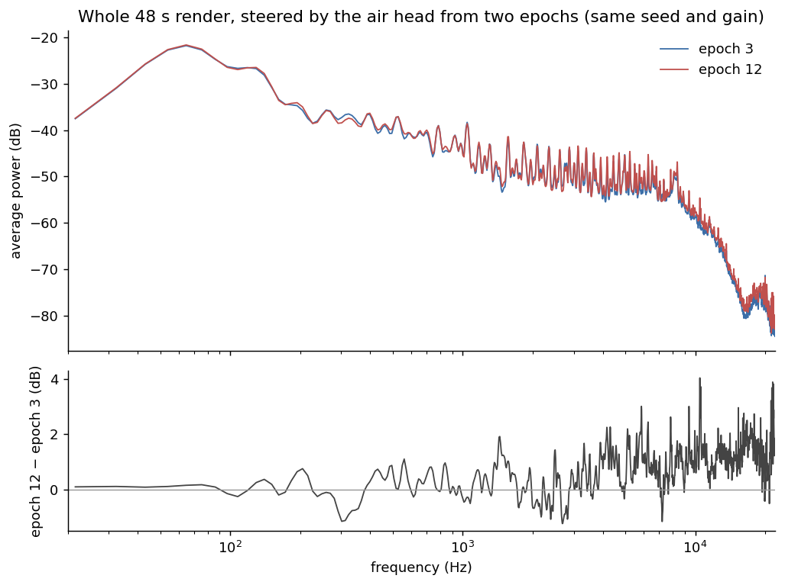
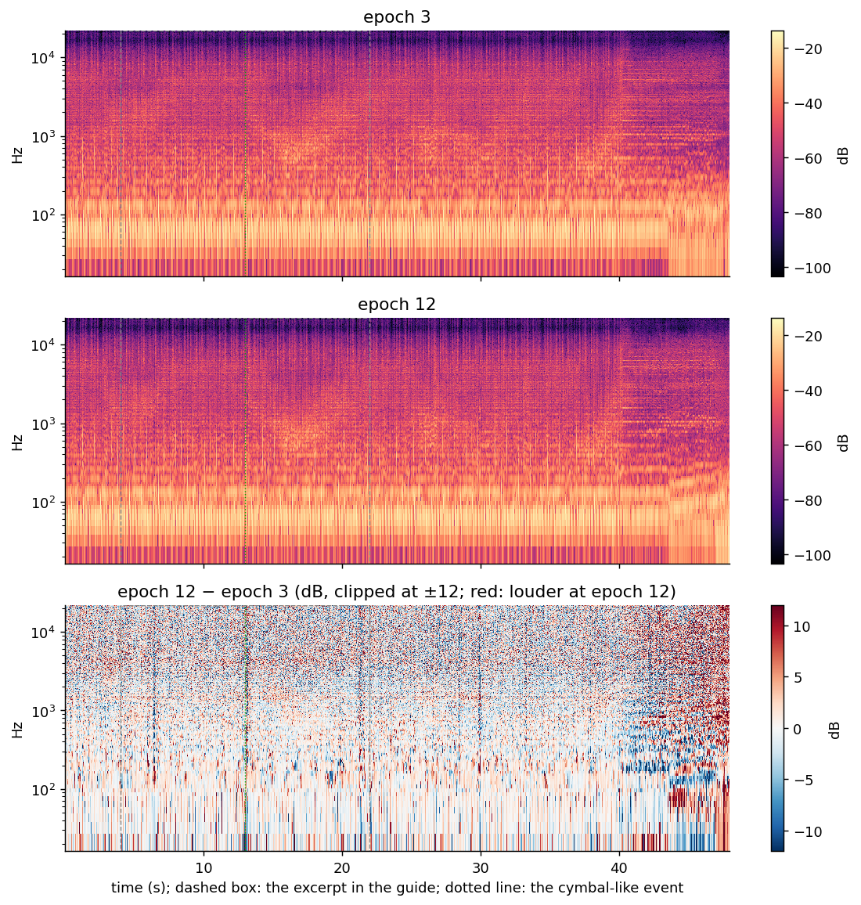

<!--
help-pane: on
DRAFT 2026-10-21, round 2 (WINTERMUTE). Restructured as "Muon and derivatives: a DIY survival guide" on the project
call of 2026-10-21 (neutral, paper-like tone; answer "coming from AdamW/Prodigy LoRAs, what changes with Muon"; a section on
every optimizer change we tried; routing diagrams; graphs and audio).
Inputs: CONTINUITY (original Muon post + Moonlight read from the PDF; own results from its journal), THE-FINN
(docs/optimizer-experiment-catalog-2026-10-21.md, a sweep of all logs; round-1 fact audit), GHOST-NOTE (hands-on results;
audio picks). Round-1 reviews (CONTINUITY theory, THE-FINN facts, GHOST-NOTE practicals) are carried into the text; their
notes are in git history (commits 1edb35a, e4983ed, ce598f6, 126cb14).
Figures: Misc/build_muon_guide_figures.py -> blog/assets/muon-survival-guide/ (every curve from a run log or optimizer
state; the step-size chart and the bf16 bars are labelled arithmetic / CPU probe).
Open before publishing:
  1. Audio: GHOST-NOTE picked and RMS-matched the four clips (provenance internal); WINTERMUTE stripped their metadata into
     blog/assets/. Nobody has listened to the selected excerpts yet; the picks rest on recorded verdicts.
  2. Done: the batch sweep (section 6) and the AIR_U10 / ON_U1 / ON_U3 results (sections 4, 9, 13).
  3. Round 3 needs its own review: the 2026-10-26 review edits, the two new sections, the third drone clip, the spectra.
  4. Nobody has listened to the rescaled drone clip as an excerpt; it rests on the 2026-10-16 verdict on the full clip.
No checkpoint names, paths, infrastructure or names of people below; arm labels (B2, B3) are how the results are filed.
Round 3 (WINTERMUTE 2026-10-27): the section-by-section review of 2026-10-26 (docs/superpowers/specs/2026-10-26-muon-guide-kim-review.md,
section C) applied; new sections 8 (DoRA vs full fine-tune) and 11 (EMA) drafted by CONTINUITY (blog/drafts/), placed and edited
here; later sections renumbered; air-head spectra (Misc/build_muon_guide_spectra.py) and a third drone clip (the runaway latent
rescaled to std 1.1, verdict of 2026-10-16) added. Fact sources per edit are in the commit message. -->

# Muon and derivatives: a DIY survival guide

This guide is for people who have trained LoRAs or fine-tunes with AdamW or Prodigy and are now trying Muon or one of
its variants. It lists what changes when you switch, the mistakes we made and how we detected them, and the result of
every optimizer change we tried between May and October 2026. Most of our evidence comes from small jobs on one 16 GB
GPU, so we say where it is thin.

## Summary

- Muon only replaces the optimizer for 2-D weight matrices. Everything else still needs a second optimizer, and how the
  two are set up relative to each other caused most of our failures (sections 3 and 9).
- A Muon learning rate and an AdamW learning rate work on different scales. Both set a change of weight per step, but
  the update they multiply has a different size: about 0.2 to 0.4 per weight for AdamW, and for Muon a size that depends
  on the matrix shape (1/16 for a 256-wide matrix). Without a rescale, the same number moves different parameter groups
  by amounts that differ by a factor of 16 or more (section 4).
- Muon's step stays full size whatever the recent gradients were. AdamW also ignores the overall scale of the gradient,
  but it remembers the last ~1,000 steps and takes smaller steps when the gradients have been noisy or have just dropped.
  Under Muon, weights can grow every step while the loss looks normal, so weight decay and logging of weight size per
  group are needed (section 5).
- At batch 1 to 16 (our LoRA and full fine-tunes) the gradient is noisy, and several add-ons designed for large-batch
  training behaved differently for us or had no measurable effect. Our control heads at an effective batch of 64 were
  already signal-dominated (sections 6 and 9).
- When fine-tuning a model that was pre-trained with Adam, two papers report that Muon brings no clear advantage for full
  fine-tuning; LoRA reduces the difference. We also could not turn our full fine-tunes into usable low-rank adapters
  (section 7), and we have no controlled comparison of adapters against full fine-tunes (section 8).

**About this guide.** It assumes you have trained a model with an optimizer such as AdamW or Prodigy, not that you know
the mathematics behind it. Section 1 lists what we trained, so you can judge how far our results travel. Sections 2 and 3
explain what Muon computes and which parameters it handles. Section 4 covers learning rates, where most of our failures
began, and section 5 how weight size shows that a run is going wrong before the loss does. Section 6 covers batch size and
gradient noise, and section 7 fine-tuning a model that was pre-trained with another optimizer, including LoRA and DoRA
adapters; section 8 compares adapters with full fine-tunes. Section 9 lists every optimizer change we tried and what it
did. Section 10 covers listening to results and choosing a checkpoint, section 11 the averaged copy of the weights (EMA)
that many trainers keep, and section 12 number precision; section 13 gives a starting configuration and section 14 what
we do not know. A few subjects come up in more than one place: weight size in sections 4 and 5, and gradient noise in
section 6 (what it is and how we measured it) and section 9 (which add-ons it affected).

**How to read this.** Underlined terms open a side explanation, some with a short check. Each section can be read
without them.

## 1. What we trained

| Job | Size | Data | Batch | Notes |
|---|---|---|---|---|
| Control heads, from scratch | 5-10 M parameters, width 256-512 | 5,401 or 12,524 crops of music latents | 8-256 effective | most of the controlled comparisons |
| LoRA / DoRA on Stable Audio 3 | rank 128-256 adapters | a few hundred to about 12,000 tracks or crops | 1-16 | listening tests, long runs |
| Full fine-tunes of Stable Audio 3 | the whole diffusion model | a few hundred to about 12,000 tracks or crops | 1-8 | few runs, several failures |

Almost every comparison below is a single run per setting. Repeating one head recipe gave held-out losses that differed
by about 0.004; a later repeat of the batch-64 onset head (section 6), same seed and recipe, differed by 0.009 (0.1802
and 0.1896). We treat differences below about 0.01 as noise.

## 2. What Muon computes

AdamW updates each weight using that weight's own gradient history. Muon works on whole matrices. For each 2-D weight
matrix it keeps a momentum (a running average of recent gradients), and replaces it with an approximately orthogonal
matrix by running five Newton-Schulz iterations, a fixed polynomial with coefficients (3.4445, -4.7750, 2.0315). In
plain terms: the gradient still decides in which directions the matrix changes, and the directions the iteration
reaches are given steps of similar size, however strong or weak the gradient was along them. The method was introduced in [Keller Jordan's Muon post](https://kellerjordan.github.io/posts/muon/)
(December 2024), with results on CIFAR-10 and GPT-2-sized language models.

Two details matter in practice. The result is only approximately orthogonal: the coefficients are chosen to put the
singular values in roughly 0.7 to 1.3, and the post reports that this error does not hurt. And directions far weaker
than the strongest one are not pulled up within five steps. The figure shows this on a real momentum matrix from one
of our heads at batch 16.

The original post also states, as open questions, whether Muon helps for fine-tuning at all. Two later papers address
this (section 7).

## 3. Which parameters go where

Muon is only defined for 2-D matrices, and the original post recommends it only for the hidden layers. Everything
else goes to a second optimizer, usually AdamW:

- embeddings (and, in our reading, other input projections);
- the final output layer (classifier head), even though it is 2-D; the post says this rule came from experiments;
- 1-D parameters: biases, normalisation gains, DoRA magnitude vectors;
- scalars.

Attention projections that are stored as one fused matrix (Q, K and V together, shape [3d, d]) should be split, so that
each of Q, K and V is orthogonalised on its own; the Muon post reports that this works better (an experiment it credits to
Vlado Boza). Fused modulation layers (AdaLN), which produce several scale and shift vectors from one matrix, are the same
situation; splitting those is our reasoning, not a tested result.

Trainers decide this from parameter names and shapes, and the rules can miss. Ours did:

In our small heads the fused attention matrix was not split (the rule looked for a different name), the AdaLN emitter
was treated as an ordinary hidden matrix, and the time-embedding layers were treated as embeddings. We do not know the
effect yet; changing the routing is a new experiment, not a silent fix. **Check what your trainer does:** print the
parameter groups at start-up and read the list.

## 4. Learning-rate scale

This is the main difference from AdamW, and it caused most of our failures.

An AdamW step moves each weight by about 0.2 to 0.4 times the learning rate ([Moonlight](https://arxiv.org/abs/2502.16982)
measured this). The orthogonalised Muon update for an m x n matrix has a size per weight of about 1/sqrt(max(m, n)) times
the learning rate (Moonlight's Lemma 1): 1/16 of the learning rate for a square or tall 256-wide matrix. The original Muon
code multiplies by sqrt(max(1, rows/cols)), which changes this for tall matrices, and in our own optimizer a row
normalisation step gives wide matrices, including LoRA A, a step 2 to 3.6 times larger. The 1-D parameters are the
biases, one number per output that each layer adds after its matrix, and the gains, one scale factor per channel in the
normalisation layers. In our heads every layer has some, but together they are well under 1% of the head. In our
optimizer they were moved by a sign step, which moves each of them by the full learning rate. One learning rate
therefore produced three different step sizes:

In numbers, per weight and per step: AdamW at its best setting for these heads (lr 3e-4) moves each weight by about
0.6e-4 to 1.2e-4. Our Muon recipe at its best setting (lr 1e-2) moved the 256-wide matrices by about 6e-4, 5 to 10 times
more than AdamW, and the biases and gains by 1e-2, 80 to 170 times more. So the learning-rate gap between the two
optimizers (about 30x) is only partly a change of scale: the matrices really took larger steps, and the biases and gains
far larger ones.

**What happened.** We trained the same head (the onset head of section 1) twice at a high learning rate, once with a
separate, smaller learning rate for the biases and gains (run B2) and once with the shared one (run B3). The separate
rate let the head train at a learning rate where the shared one failed: in B3 the biases and gains grew until the run
broke down, while in B2 they stayed small. It did not make the high rate worth using; the head did no better than at
its usual rate. And lowering the shared rate far enough to protect the biases made the matrices learn too slowly.

**The fix in the literature.** Moonlight scales the Muon update by 0.2 x sqrt(max(m, n)) so that every matrix moves
about 0.2 times the learning rate per weight, the size of an AdamW step. The non-matrix parameters stay on AdamW with
the same learning rate and weight decay. [SF-NorMuon](https://arxiv.org/abs/2605.23061) uses the same rule. After this
rescale, the papers use AdamW-style learning rates for both groups (in language-model pre-training). Some implementations
already include it; check yours. Our heads still wanted larger steps than that: the best rescaled setting we have found
so far is lr 3e-3, about 10 times AdamW's best lr, which is about 5 to 10 times AdamW's per-weight step.

**Our first test of it.** On a small head that had diverged at every learning rate above 1e-2 we tried, the rescaled
recipe at lr 3e-3 trained for all 25 epochs and reached the same held-out loss as the old recipe at its best setting
(0.0207 against 0.0206). This is an equal-step comparison: 0.2 x 3e-3 moves the matrices as far per step as 1e-2 / 16
did. It shows that the conversion works, not that the usable range is wider.

**The range test.** We then ran the same recipe at lr 1e-2, which moves the matrices as far per step as the old recipe at
lr 3e-2. At that step size the old recipe became NaN on this head twice, in epochs 15 and 26. The rescaled run did not
diverge: the weight size of the matrices levelled off at about 0.26 (0.11 at lr 3e-3), and no learning-rate cut was
needed. Its best held-out loss, 0.0225, was worse than the 0.0207 at lr 3e-3, and the loss rose from epoch 17, so the stop
rule (section 5) ended the run after epoch 19. Two limits: the old runs used a batch of 64 and this one 32, and the
rescaled recipe changes two things at once (the matrix scale and AdamW for the biases and gains), so we cannot say which
of the two prevents the divergence. What we can say: a learning rate 3 times too high now costs some loss instead of the
run.

**On a second head** (the onset head of section 1) the rescaled recipe at lr 1e-3 reached 0.1798 and was still improving
at epoch 20; at lr 3e-3 it reached 0.1829 at epoch 14 and then drifted up. The old recipe's best on this head was 0.1822.
These three differ by less than we would expect from changing the random seed. The best rate differed between the two
heads (3e-3 for the air head, 1e-3 for the onset head), so we would start a new job at 1e-3 and try 3e-3.

## 5. Weight size, weight decay, and how to see a run going wrong

Neither optimizer cares about the overall scale of the gradient: multiply every gradient by 100 and both take the same
steps. The difference is memory. AdamW divides by a running average of squared gradients that remembers about 1,000
steps, so after the gradients drop, or while they are mostly noise, its steps shrink for a while (with pure noise and
momentum 0.9, to about 0.23 of full size). Muon's orthogonalised step is full size on every step, however the gradients
have been behaving. A matrix can grow every step while the loss looks normal. The loss does not show this because most
layers in these models are followed by a normalisation that undoes a change of overall scale: a matrix twice as large
gives almost the same output, so the loss barely changes until the growth reaches a part that is not normalised, or the
numbers get too large to store accurately (that is our reading of the mechanism; the observation itself is below). In
each of the failures below, the weights grew before the loss showed a problem:

- B3 above: biases and gains grew about 170-fold over B2's at the same step before the loss became NaN.
- A small head at lr 5e-2 with a separate rate for the biases: its matrices grew 15-fold in 460 steps, then NaN. Here
  the matrices themselves stepped too far.
- Full fine-tunes of Stable Audio 3 without weight decay: the latents the model produced grew from a standard deviation
  of about 0.7 to 1.3 by epoch 3 and 5.6 by epoch 7 (a healthy model is near 1.1). The audible result was a drone under
  the music. The optimizer's default weight decay was zero and our full fine-tune path never set it. AdamW runs with decay
  0.01 on the same data stayed healthy.

Three clips from one sweep of full fine-tunes, same prompt, seed, guidance scale and epoch (7). In the first run the
generated latents sat at a standard deviation of about 3.0 (healthy is about 1.0 to 1.15): a distorted drone at every
guidance scale. The second clip is the same latent scaled down to 1.1 before decoding: the distortion goes, the drone
stays. The level can be fixed afterwards; what the model generated cannot. The third clip is a different run of the same
sweep, whose latents stayed low (0.59). It is not distorted, but it is not healthy music either: by ear it is smooth
whooshes and disjointed. None of the three is a good model. All three use the runs' EMA weights (section 11), which at
that point were still more than half the starting model, and the cause of the first run's growth is only partly
established. The clips show what weight growth sounds like, not what a healthy run sounds like.

Moonlight reports the same effect at large scale: without weight decay, the weights and layer outputs grew past the range
bf16 represents well, and the advantage over AdamW shrank. [Muon-SW](https://arxiv.org/abs/2607.23777) reports that with a
constant weight decay Muon's weight norm shrinks steadily over training, and scales the decay with the learning rate so
that the norm settles. (Under Schedule-Free, where the learning rate does not decay, that scaling has no effect.) [Hyperball](https://arxiv.org/abs/2606.16899) fixes the norm outright; we found it is not a
drop-in for adapters, because a matrix that starts at zero has norm zero and does not move. Background on why weight
decay sets the effective step size: [Rotational Equilibrium](https://arxiv.org/abs/2305.17212) and
[Weight Decay may matter more than muP](https://arxiv.org/abs/2510.19093).

**What to log.** In order of how often each one warned us first:

1. The RMS of the weights in each parameter group, every few hundred steps. A group that doubles within an epoch after
   warmup needs attention. Our head trainer can halve that group's learning rate automatically; the option is new and off
   by default.
2. The RMS of the update in each group, and the ratio update / weight. A ratio that stays far above the other groups is
   the group that will run away.
3. Loss as a median plus a count of spikes, not as a mean. A log usually shows one number per stretch of steps (a
   logging bin; 1,000 steps in the run below). A mean over a bin is pulled up by a few huge steps, so it can fall while
   the run gets worse; the median is the typical step and ignores them. In one full fine-tune the mean per bin fell from
   405 to 84 and looked like convergence, while the median stayed at 2.5, against 0.79 for a reference run on the same
   data, and 38% of the steps had a loss above 5, more than six times that reference's typical step. The run was
   diverging the whole time. Gradient clipping at 1.0 did not change that. (Check what your trainer logs, too: ours
   once logged half the real loss, because the loss was divided by the number of accumulated batches before it was
   logged.)
4. For generative models, the size of what the model produces. For us that is the standard deviation of the generated
   latents; values from 1.3 up were the early stage of the drone above.
5. Finite checks on the saved weights and on test outputs, both. In one LoRA run, test renders had latents up to 10^10
   that a clamp in the demo code hid, while every saved tensor was finite. Neither check alone would have caught it.
6. The path of the weights over the run: the distance from the start, the speed per step, and the path efficiency (the
   straight-line distance divided by the length of the path). In our DoRA full-rank runaways the layers moved in lockstep. Path efficiency
   alone does not separate healthy from runaway runs: the DoRA runaways read 0.14 to 0.23, but a healthy run read 0.216.
   (Healthy here means it trained all 22,000 steps without breaking down, and its total weight size, the global norm,
   grew only 15% over the run, against 10 to 17 times for the failed runs.) The global norm (99-114 healthy against
   4,085-12,189) and the speed per step did separate them.

**Stops.** Our head trainer now stops at the first non-finite loss, and when the held-out loss stays above 1.5 times its
best for two epochs, or rises three epochs in a row and is more than 5% above its best. Replayed on our recorded runs,
the second rule would have stopped B3 at epoch 4 instead of 13 and left the healthy runs alone.

**Check that each mechanism is active.** We audited our own modular optimizer and found that three of its mechanisms (escape
velocity, a variance-damping tier, and Schedule-Free averaging when its burn-in was longer than the run) had no effect on
the step, and that its NaN guard could not detect NaN (a comparison with NaN is always false). Results from runs where a
mechanism was inactive say nothing about that mechanism. Log a counter or a value that shows each one changes the step.

## 6. Batch size, dataset size and gradient noise

A gradient from a small batch is the true direction plus noise. With batches of 1 to 16, as on most consumer GPUs, the
noise is large relative to the signal. Momentum averages over the last 10 to 20 steps and removes much of it. Anything
that looks at the difference between two consecutive gradients, or at a per-element signal-to-noise ratio, mostly
measures noise at these batch sizes (section 9). Momentum is not free: an average over the last 10 to 20 steps also
lags behind, so the step points where the gradient was a few steps ago. We have not measured what that costs us, in
generalisation or otherwise, or how it depends on the size and variety of the dataset.

Muon adds a specific problem: because weak directions get steps comparable to strong ones (within the limits shown in
section 2), noise directions in the momentum also get a real step. The [SAMuon paper](https://arxiv.org/abs/2608.25990)
reports that its improvement over Muon grows with batch size. [A paper on noise scales for sign and spectral descent](https://arxiv.org/abs/2602.03001)
gives the matching way to measure the noise and choose a batch size (the classic version for SGD is
[McCandlish et al.](https://arxiv.org/abs/1812.06162)). Our first attempt to measure it, by comparing the two halves of
each batch of 16, could not separate signal from noise.

For AdamW the picture can be different. In one comparison of two adapter fine-tunes of Stable Audio 3 with AdamW (2,000
optimizer steps each), the run at an effective batch of 8 (by accumulation) behaved the same as the run at batch 1 in
every statistic of the weight path we logged: how consecutive updates correlate, how much of the gradient repeats from
step to step, and drift.

Two practical points on batch size:

- **Gradient accumulation gives a larger effective batch without more memory.** Our heads are compute-bound on the GPU,
  so an epoch takes the same time at any effective batch. A larger batch takes fewer, less noisy steps over the same data.
  It is not quite the same as a real batch of that size. Anything counted in steps changes: warmup, schedules and logging
  intervals cover more data per step. Anything updated per small batch rather than per optimizer step runs more often than
  the settings suggest; in our trainers that was the EMA (section 11). The loss may be averaged per small batch and then
  per step, which weights crops slightly differently from one big average. And layers that compute statistics over the
  batch (batch normalisation; our models have none) only ever see the small batch.
- **Compare batch sizes at equal steps, or say you did not.** In one of our sweeps the batch-32 run had half as many
  steps as the batch-16 run in the same number of epochs, and the batch-8 run twice as many. Its result that "batch 8 is
  as good as 16" came from the extra steps; at equal steps batch 8 was worse.

We then trained the same head (onsets per beat, width 256, depth 8, same held-out split) at effective batches of 64,
128 and 256 for the same number of epochs, and measured the noise from the two halves of each accumulated batch:

| Effective batch | Learning rate | Best held-out loss |
|---|---|---|
| 64 | 1e-3 | **0.1802** |
| 128 | unchanged | 0.1917 |
| 128 | × √2 | 0.1935 |
| 256 | × 2 (√ rule) | 0.1964 |
| 256 | × 4 (linear rule) | 0.1900 |

Batch 64 was best. Above it, the linear rule beat the square-root rule, and the noise measurement says why. The cosine
between the two half-batch gradients was between 0.37 and 0.08 over the run. For a half-batch gradient made of signal
plus independent noise, that cosine is δ²/(1 + δ²), where δ is the half-batch signal-to-noise ratio. The full batch has √2
times that ratio, and a momentum buffer with β = 0.9 another √((1 + β)/(1 − β)) ≈ 4.4. That puts the momentum's ratio
between about 1.9 and 4.7: signal-dominated. The square-root rule assumes the update is noise-dominated, which here it is
not, so it under-steps. For a noise-dominated update at β = 0.9, the half-batch cosine would have to be below about 0.006.
So the noise argument at the start of this section applies to batches of 1 to 16, as in our LoRA and full fine-tunes; at
an effective batch of 64 our heads were already past it.

**What the held-out loss hides.** The optimizer comparisons in this guide differ by a few percent of held-out loss, and
the curves track each other closely. Splitting the held-out loss by noise level t (the same crops and the same noise at
10 fixed values of t; t near 1 is almost pure noise) shows why:

| t | Muon, batch 64 | AdamW, constant lr | Muon, batch 256, linear lr |
|---|---|---|---|
| 0.05 | 0.090 | 0.124 | 0.098 |
| 0.25 | 0.097 | 0.130 | 0.107 |
| 0.45 | 0.123 | 0.153 | 0.135 |
| 0.65 | 0.184 | 0.190 | 0.191 |
| 0.75 | 0.236 | 0.243 | 0.244 |
| 0.95 | 0.460 | 0.479 | 0.467 |

(Predicting the target's mean scores 0.963 at every t.) For all three heads, about half the loss (51–55%) comes from
t > 0.7, where the latent says little about the target and the heads differ by 4–8%. That half is a floor that the
optimizer barely moves, and averaging over t dilutes everything else. On the cleaner latents (t ≤ 0.45), AdamW's loss is
25–39% higher than Muon's. A 13% difference in the average is a 30%-plus difference where the latent carries the
information. Sampling with guidance spends most of its budget on the late, low-noise steps, so this part probably matters
more for steering than the average suggests; we have not yet checked that against listening. Our trainer now logs the
held-out loss per t-bin every epoch, so we can see when each noise band stops improving.

On dataset size: our heads trained on 5,401 and on 12,524 crops gave the same ranking: the Muon-type optimizer ahead of
AdamW on both (held-out loss 0.357 against 0.408 on the smaller set, 0.20-0.21 against 0.25-0.26 on the larger, section
9). On the larger set every curve was still falling at 10 epochs, so a short run ranks learning speed, not final
quality. In one sweep the setting that finished best led only from epoch 8 of 10; clear failures were visible by epoch 2
or 3. A falling loss does not mean a model is still getting better to the ear, either: the training loss of our adapters
kept falling while their renders had already started to ring, and the held-out loss of the air head in section 10 kept
improving long after its last clean epoch.

## 7. Fine-tuning a model pre-trained with Adam

Adam and AdamW differ only in how weight decay is applied (AdamW takes it off the weights directly instead of adding it
to the gradient). For the question in this section they are the same optimizer, and the papers below say "Adam" for
either. Moonlight reports that the advantage of Muon holds when both pre-training and fine-tuning use Muon. When they differ,
fine-tuning with Muon showed no significant advantage over AdamW; on an Adam-pre-trained 7 B model the two were on par.
[Can Muon Fine-tune Adam-Pretrained Models?](https://arxiv.org/abs/2605.10468) studies this in detail:

- Fine-tuning with the other optimizer than the one used for pre-training is more sensitive to the learning rate and
  forgets more.
- In full fine-tuning on math and code, Muon moved the weights 5.6 to 7.4 times further from the pre-trained ones than
  Adam did. With LoRA this reverses (0.2 to 0.8 times as far).
- LoRA reduced the gap by 78% for Adam-pre-trained models. In the case with the largest mismatch, LoRA with Muon beat
  LoRA with Adam at low and moderate ranks and became worse at high ranks.
- The paper uses cosine decay with 3% warmup throughout; it does not use a constant learning rate. Its Muon is the
  Moonlight variant, so its learning rates are in AdamW-like units.

Three versions of Muon appear in this guide: the original (textbook) one, the Moonlight variant with its AdamW-size
rescale, and our own optimizer with its row normalisation (section 9). We have not compared the three against each other
on the same job, so we cannot say which is best for fine-tuning.

Which optimizer pre-trained Stable Audio 3 is not stated in its report. Its post-training stage used Muon at lr 1e-5 on
the attention and feed-forward matrices and AdamW at lr 1e-6 on the rest, with a decaying schedule
([Stable Audio 3 report](https://arxiv.org/abs/2605.17991)). A developer of the model told us (not published) that the
base model was pre-trained with the same split, Muon on the 2-D matrices and AdamW on the rest, but that Muon was adopted
late and used only briefly, so the base model is mostly shaped by AdamW. Do not copy a learning rate from a from-scratch
setup to a fine-tune.

Two observations from our own LoRA and DoRA runs:

- **LoRA A barely moves.** A reads the input and B writes the correction; A starts random and fairly large, B starts at
  zero. Each row of A is a direction in the input that the adapter listens to, and "rotation" means those directions
  turning toward new ones during training. In one run, 99.2% of the space spanned by the rows of A was unchanged between
  steps 240 and 1,440, against 35% for the corresponding space of B, so the adapter kept listening to almost the same
  random directions for the whole run. The likely reason is the fixed-size step: each step is a tiny fraction of a large
  A, so it barely turns it. (We also counted A's share of the update, about 7%, but with every row normalised that share
  mostly reflects A's row count, so it is not evidence.) No averaged copy of the weights was involved: our trainers keep
  an EMA only for full fine-tunes (section 11). We have no AdamW control for this; an imbalance between A and B is also
  known for AdamW ([LoRA+](https://arxiv.org/abs/2402.12354)), though the mechanism there differs, so do not read it as
  specific to Muon. A larger learning rate for A (20 times) rotated it, but also made the adapter 2.3 times larger and
  produced one NaN render, so the result is not clean.
- **DoRA magnitudes can cross zero.** DoRA's per-row magnitude parameters started between 0.13 and 0.45. A fixed-size
  step (sign descent: every magnitude moves by exactly the learning rate, up or down by the sign of its gradient) moved
  592 of them to zero or below by step 6,340, and the run became NaN near step 6,900. No paper we found reports this.
  Our fix is a multiplicative update, which scales each magnitude by a factor slightly above or below 1 instead of
  adding a fixed amount, so it can never change sign. It is our own change and is **untested**: the retry with only this
  change stopped at step 1,268, before the point of failure. AdamW's steps are smaller (0.2 to 0.4 x lr) and their sign
  is noisy, so a crossing is slower there, but moving small positive scalars to AdamW does not by itself guarantee they
  stay positive.

**Extracting an adapter from a full fine-tune did not work.** We tried to distil full fine-tunes of Stable Audio 3 into
LoRA and DoRA adapters (ranks up to 128) with a truncated singular value decomposition of the weight change: 60 adapters
from 10 full fine-tunes. All of them glitched when rendered. The extraction itself was correct: rebuilding the weights from
the saved adapter tensors matched the full fine-tune with a cosine of 0.99, and DoRA's magnitudes came out exact. The cause
is rank. The weight change of a full fine-tune is close to full rank: the rank needed to hold 90% of its energy was a median
of about 750 to 1,110 per matrix in 1,536-wide layers. A rank-128 adapter kept about 26% of the energy over the whole model
and between 40% and 68% in the attention matrices. An adapter that keeps more of some matrices than of others is
lopsided, and it sounded broken. About 1,000 would be needed for 90% overall, so no useful adapter rank exists for these
fine-tunes. Adapters trained directly at low rank do not have this problem, because training finds a low-rank change that
works as a whole. This is one family of fine-tunes and one extraction method; we did not try choosing the rank per matrix.

## 8. DoRA adapters against full fine-tuning: what we can and cannot say

A full fine-tune changes every weight of the model. A DoRA (or LoRA) adapter freezes the model and trains a small add-on
(section 7). We used both on the same base model, and the honest summary is that we have **no controlled comparison**: no
experiment trained both on the same data, for the same budget, with several seeds, and judged them by ear. What we have
is the following.

**1. Memory decides what is possible on one 16 GB card.** A rank-16 DoRA trains about 21.6 million parameters against a
frozen base. In a memory test, a full fine-tune of Stable Audio 3 medium with AdamW ran out of memory at 15.13 GiB, while
Lion in bf16 with stochastic rounding fitted, and so did one of our own Muon-type optimizers with some of its components
switched off. "Fitted" is a memory result only: we have not trained a Lion full fine-tune to completion on that card, and
every Lion run we trained was an adapter.

**2. By ear, early verdicts favoured full fine-tunes in fp32, but the comparison is mixed up.** In July, listening (one
listener) judged fp32 full fine-tunes better than bf16 ones and than adapter-only runs, and found that a higher adapter
rank helped. That verdict mixes three differences (precision, adapter against full, and rank), and it comes from runs of
8 epochs or fewer. It is a lead, not a measurement.

**3. The automatic scores point the other way on one dataset, and nowhere on the other.** Over a campaign of about 265
runs (810 checkpoints), the scores we use as a stand-in for the ear (a perceptual-quality score that agreed with 77.6% of
668 A/B listening votes, and a text-audio similarity score that mostly repeats it) favoured DoRA over full fine-tuning
on one dataset only. After removing 60 mislabelled checkpoints, the advantage on the other dataset disappeared
(p = 0.49). Checkpoints from the same run are not independent, so our first analysis overstated its significance; at the
level of whole runs only the dataset, the adapter scaling, the rank and the optimizer survived.

**4. The two fail in different ways.**

| | Adapter (DoRA) | Full fine-tune |
|---|---|---|
| Typical failure we hit | magnitudes crossing zero, then NaN (section 7); whole-model runaway at high rank | weights and output level growing without weight decay (the drone, section 5); averaged copies that had barely moved (section 11) |
| Rendering | on our GPU stack, live (unmerged) adapters returned NaN in 2.6 to 7% of renders from late July; merged adapters were stable | stable throughout |
| Learning-rate scale | about 5e-4 with our modular optimizer | about 5e-6 with our fusion optimizer, a hundred times smaller |

The last row is the learning-rate point of section 4 again: the numbers do not carry over between optimizers, networks or
kinds of training.

**5. The optimizer changes the sound, not just the loss.** Lion fine-tunes sounded fine but stylistically different from
AdamW and from our own optimizer, so two models with the same loss are not interchangeable. For full fine-tunes, our own
optimizer at a very low learning rate (5e-6) produced the clips we liked best in the one comparison we ran.

**6. Turning a full fine-tune into an adapter did not work** (section 7): the weight change of our full fine-tunes is
close to full rank, and a rank-128 adapter kept about 26% of it.

**What we do not know.** Whether a DoRA trained at a high rank for as long as a full fine-tune reaches the same sound;
whether the dataset effect (adapters ahead on one dataset only) comes from the data, the captions or the number of
epochs; and whether a Lion full fine-tune sounds as good as an adapter.

*Known:* the memory test, the failure profiles, the extraction result. *Preliminary:* the July listening verdicts. *Our
reading:* that the dataset, not the method, explains most of the adapter advantage. The evidence for every comparison in
this section is weak.

## 9. Every optimizer change we tried

Results are single runs unless stated; differences under about 0.01 on the heads are noise (section 1). "Head" means the from-scratch
control heads of section 1. Methods marked *(ours)* are our own; the others link to the paper they come from, and our
implementation of them may differ from the paper's.

Most of the add-ons below were developed for pre-training large language models with very large batches, and few of
them showed the papers' gains for us. Our estimates of why, none of them tested: our batches are small (1 to 64), so
methods that read signal from the gradient read mostly noise (section 6); our heads are small and our fine-tunes start
from a model pre-trained mostly with AdamW (section 7); our runs are short, so a method that pays off late never gets the
chance; and with single runs and noise of about 0.01, a gain of a few percent would not show.

| Change | What it does | What we found |
|---|---|---|
| Muon-type optimizer vs AdamW (heads) | orthogonalised matrix updates, with Schedule-Free | 0.357 against 0.408 at 10 epochs on 5,401 crops; best lr about 30x AdamW's |
| [Schedule-Free](https://arxiv.org/abs/2405.15682) averaging | evaluates and saves an average of the weights instead of decaying the lr | the largest single effect: 0.20-0.21 with, 0.255 without, AdamW 0.25-0.26 (12,524 crops). Its burn-in and averaging weight (sf_r) moved results by 0.0005 to 0.006 against a noise of about 0.01 |
| [Shampoo](https://arxiv.org/abs/1802.09568) / [Mousse](https://arxiv.org/abs/2603.09697) preconditioner | rescales the gradient by its curvature before Newton-Schulz | switching it on or off made no measurable difference on heads; it was on in all our head runs by default. Our reading: Newton-Schulz already evens out the step across directions, which is most of what the preconditioner does |
| [SOAP](https://arxiv.org/abs/2409.11321) | a different curvature preconditioner | 0.0212 against 0.0206 on one head, slower; ran out of memory in our FiLM-adapter test |
| Full Fusion stack *(ours)*: Newton-Schulz, MONA, KL-Shampoo, NorMuon, Schedule-Free | our earlier combined optimizer | 12-20% lower error than AdamW at equal wall time on the older heads; Newton-Schulz with NorMuon and Schedule-Free alone gave almost all of that, and MONA and KL-Shampoo on top added about 1% for 50% more time. Not compared directly with our current optimizer |
| KL-Shampoo, on its own | Shampoo-style preconditioner without Newton-Schulz | diverged to NaN in the first epoch: nothing bounded the step size. Public Shampoo code avoids this by borrowing the step size from Adam ("grafting"); ours did not. Inside the Fusion stack, Newton-Schulz bounded it and it was stable |
| [MONA](https://arxiv.org/abs/2605.26842) | adds a term from the difference between consecutive gradients | worse than AdamW in one comparison; crashed at high lr on another head. At small batch that difference is mostly noise; not a clean test |
| [NorMuon](https://arxiv.org/abs/2510.05491) | rescales each row of the update to the same size | in our version, making every row the same size undoes the shape-based scale factor completely. Our version also leaves out a step of the reference implementation that restores the update's total size, so on wide matrices ours steps larger by the square root of their width-to-height ratio (2.1x at 256 x 1024, 3.6x at 128 x 1536). No outcome test yet |
| Separate lr for biases and gains | 1-D parameters on their own lr | on the onset head (section 4): trains at a high lr where a shared lr does not; at the usual lr it makes no difference |
| Update rescaled to AdamW size + AdamW for 1-D | the rule of [Moonlight](https://arxiv.org/abs/2502.16982) and [SF-NorMuon](https://arxiv.org/abs/2605.23061) | on the air head and the onset head: the same loss as their old best settings; on the air head at 3x the step size where the old recipe became NaN, it trained, with somewhat worse loss and weights that levelled off |
| Radial brake *(ours, after an NVIDIA training hook)*, escape velocity *(ours)*, burn-in | radial brake: after each step, if a matrix's size (its overall norm) grew, keep only part of the growth. Fixed-size steps make weights grow because each step adds a little size even when it is not aimed outward. Escape velocity grows the step over time; burn-in delays the averaging | all within 0.001-0.006 of the plain recipe, i.e. inside the noise. A likely reason for the brake: in those head runs the weights were not growing out of control, so there was little to brake. No listening test. Escape velocity was inactive in early runs and later raised the step from 1.0 to 1.6x while a run was diverging |
| Variance damping (VADD) *(ours)* | lowers the step when the loss variance is high | applied its factor twice when it fired (a bug, fixed); in an ablation, removing it did not change the adapter's size |
| Signal-to-noise gate *(ours)* | scales each element by its estimated signal-to-noise ratio | sat at its own noise floor (0.18-0.21), so it acted as a fixed cut of the lr to about 0.2x. Removing it from a DoRA run made the adapter 4.4x larger in 1,011 steps |
| Gradient clipping at 1.0 | caps the gradient norm | did not prevent any of four divergences at lr 3e-2 to 1e-1, and did not reduce loss spikes in a full fine-tune. Under Muon the step size comes from the lr, so clipping the gradient changes little |
| [AdaGC](https://arxiv.org/abs/2502.11034) | per-tensor adaptive clipping | at a tight setting it clipped 68% of steps and bent the adapter's path; at a loose setting about neutral |
| [Cautious](https://arxiv.org/abs/2411.16085) masking | drops update elements whose sign disagrees with the gradient | after Newton-Schulz about half the elements disagree at random, so the mask removes a random half. The rescale of the survivors increased the update by 37% and one DoRA run became NaN; fixed |
| [D-Adaptation](https://arxiv.org/abs/2301.07733) / automatic step size | estimates the lr during training | three of four DoRA rank-128 runs ran away (global norm 10-17x its healthy value); the run without it stayed healthy for 22,000 steps |
| [Prodigy](https://arxiv.org/abs/2306.06101) | automatic lr for AdamW | not tested standalone with Muon; a Prodigy-style step growth inside our optimizer trained a 13,500-step run without problems. On our older (pre-Muon) heads Prodigy was about 3% better than AdamW (0.1486 vs 0.1534) at 35% more time |
| [Lion](https://arxiv.org/abs/2302.06675) | sign of the momentum, fixed step | 0.228-0.262 against about 0.20 on heads, the best Lion setting was the lowest lr tried; adapters trained with it sound fine but stylistically different from AdamW (section 8). It keeps one buffer per weight against AdamW's two, which is what lets a full fine-tune fit in 16 GB (section 8) |
| Cosine decay / damping schedules | lower the lr over the run | cosine cut the update size 10x and made late steps more consistent; it did not prevent divergence at lr 5e-2. On the older AdamW heads cosine helped a too-high lr and hurt a good one. A 16-run comparison of [WSD](https://arxiv.org/abs/2404.06395) vs our braked optimizer on LoRA and DoRA was trained but not analysed |
| Weight decay scaled with training length | decay grows with the square root of the epoch count | the weight norm grew sub-linearly over 13,500 steps, as predicted |
| Weight decay of zero | default in our full fine-tune path | drone from weight growth (section 5) |
| Multiplicative DoRA magnitude update *(ours)* | scales magnitudes instead of adding to them | our fix for the zero-crossing (section 7); untested, the retry stopped before the point of failure |
| Larger lr for LoRA A (x20) | compensates for A barely moving | rotated A, adapter 2.3x larger, one NaN render; confounded |
| [LoRA-TSD](https://arxiv.org/abs/2609.02734) | sizes the step on the adapter's product B·A, not on A and B separately | implemented, never trained |
| [Hyperball](https://arxiv.org/abs/2606.16899) | fixes the norm of weights and updates | not usable on zero-initialised adapters; a full fine-tune run was trained, result not analysed |
| EMA of the weights | smoothed copy for evaluation | helped one head (3x the control effect). An EMA that has not converged can still be mostly the starting weights; two such copies rendered non-finite output (section 11) |
| fp32 optimizer state | keep momentum and averages in fp32 | in a CPU test bf16 kept 29%/64%/92% of the weight change at lr 3e-4/1e-3/3e-3; in a FiLM adapter the K/V matrices moved 7x further with fp32 state, at equal loss; 13-21 ms per step |
| bf16 Newton-Schulz | run the orthogonalisation in bf16 | optimizer update 323 ms to 101 ms per step; quality effect not measured |
| Per-group lr watchdog *(ours)* | halves a group's lr when its weight size doubles within an epoch | new; did not fire in the one run that used it |
| Larger batch by accumulation | fewer, less noisy steps | on the onset head an effective batch of 64 beat 128 and 256; above 64 the linear lr rule beat the square-root rule (section 6) |

## 10. Listening, and choosing a checkpoint

The small heads in this guide are not generators: they predict a feature (here, the energy in the highest frequency band)
from the model's latents, and steer generation through their gradient. Loss curves and our automatic glitch detectors
missed artefacts that were audible. On one air-band head (width 512, lr 1e-2, 25 epochs) the held-out loss kept
improving until epoch 16 (0.0364 at epoch 3, 0.0318 at epoch 4, 0.0201 at epoch 16), but by ear (one listener) the last
clean epoch was the third. From epoch 4 on there are sub-second dropouts in which part of the sound is smoothed away. In
the excerpt below the epoch-12 clip has them near 0:09, around a reverse-cymbal-like sound, and a glitch near 0:02 as
well. (The
renders were also steered by two other heads, for bass and body, held fixed across epochs; one dropout in the fade-out was
attributed to those, and the excerpt does not include it.) In runs of the same head at lr 3e-2 the dropouts gathered
around the same cymbal-like sound. Whether the later-epoch dropouts come from the head over-fitting or from its EMA copy
of the weights (half-life 2 epochs) we have not tested.

A steering head's glitches depend on the sound it steers: this one over-steered a bright cymbal. Our reading is that a
head controlling the highest band acts hardest where the music already has energy there. Listen to clips that contain
the kind of sound your head acts on, not only to average material.

Generation steered by the head from epoch 3 and from epoch 12, same seed and guidance gain (24000), an 18-second excerpt
(4 to 22 seconds of a 48-second render) chosen to contain that sound.

The spectra of the whole 48-second renders (2048-sample windows, 50% overlap, FFT padded to twice the window) show what
the later head does on average: epoch 12 has 1.1 dB more energy than epoch 3 between 8 and 16 kHz and 1.5 dB more above
16 kHz, which is the band the head is trained to steer; below 2 kHz the two are within 0.3 dB. The difference over time
shows the cymbal-like sound at 13 seconds as a stripe. We could not pick out the dropouts themselves by eye at this
resolution; they are easier to hear than to see.

For LoRA and DoRA, choose a checkpoint by listening (or by whatever check fits your data), not by the final step and not
by held-out loss alone. An optimizer that moves the weights quickly early, as Schedule-Free did for us, can make
epochs 2 to 4 the good ones. If your trainer keeps an EMA copy of the weights, check which copy your render script loads
(section 11).

## 11. EMA: a slowly updated copy of the weights

An EMA (exponential moving average) of the weights is a second copy of the model that follows the training weights with a
delay. After every update it moves a small fraction of the way toward the current weights, so single noisy steps average
out. It is the same idea as momentum, applied to the weights instead of the gradients, and this is the textbook version.

**The decay is a timescale counted in EMA updates.** With a decay of 0.9999 the copy keeps 99.99% of itself at each
update. Its half-life is ln(0.5) / ln(0.9999), about 6,931 updates, and after U updates the share still sitting on the
starting model is 0.9999 to the power U. Dividing the number of updates a run performs by the half-life gives a ratio,
R, which tells you what you will get:

| R | What the EMA copy is |
|---|---|
| below 1 | mostly the starting model |
| about 2 | conservative |
| 3 to 10 | the useful range for a fine-tune (our rule of thumb, not from the literature) |
| far above 10 | mostly the recent path of the weights |

We aim for a half-life of about 5 to 20% of the planned training, so that the copy turns over during the run.

**Our trainers update the EMA on every small batch, not on every weight change.** This is a property of the trainers we
used (we read it in the code; it is not universal). With gradient accumulation 4, the EMA gets four updates per weight
change, so its memory measured in weight changes is four times shorter than the decay suggests. Three full fine-tunes of
ours show what that does:

| Run | Weight changes | Accumulation | EMA updates | Still on the starting model | R |
|---|---|---|---|---|---|
| A | 3,000 | 4 | 12,000 | 30% | 1.7 |
| B | 6,000 | 4 | 24,000 | 9% | 3.5 |
| the same 3,000 steps as A without accumulation | 3,000 | 1 | 3,000 | 74% | 0.4 |

**Moving a decay between batch sizes.** A decay copied from another recipe means little without that recipe's effective
batch size (batch times devices times accumulation). To keep the same span of data, raise the old decay to the ratio of
the batch sizes: 0.9999 at batch 32 becomes 0.9996 at batch 128 (half-life 1,733 updates) and 0.999988 at batch 4
(half-life 55,449). It looks backwards, but a larger batch sees more data per update, so the decay has to move away from
1 to keep the same span.

**What went wrong for us.**

- *Rendering a copy that had barely moved.* Several tools prefer the EMA copy when a checkpoint contains one, silently. In
  a sweep of full fine-tunes the EMA copies still held about 55 to 62% of the starting weights, so what we heard was mostly
  the starting model, and the arms of a comparison came out alike for that reason alone (the drone clips in section 5 are
  from that sweep). Check whether your checkpoint has an EMA copy and which copy your render script loads.
- *An unconverged copy can be unusable, not just weak.* Two full fine-tunes whose EMA copies still held 24% and 47% of the
  starting model at epoch 11 rendered non-finite audio; later epochs, at 1.8 to 3.5 half-lives, rendered cleanly. That is
  two runs, so treat it as a warning, not a rule.
- *Averaging can blur what you trained.* For a short fine-tune at a low learning rate, the EMA copy is not automatically
  better: it can blur exactly the behaviour you were after. We save and audition both the live and the EMA weights.

**Where we use one.** Our Stable Audio 3 trainers keep an EMA only for full fine-tunes; they switch it off for LoRA and
DoRA, so none of our adapter results depend on an EMA copy. The control heads use one: in one feature test an EMA of
0.999 with gradient accumulation 2 gave about three times the effect of the live weights (one feature, so weak
evidence), while for the onset head the EMA and live weights were indistinguishable at a half-life of half an epoch.

**A short checklist.** Write down R at launch; choose the half-life as a share of the whole run; convert decays with the
batch-size rule; save and audition both copies; and confirm which copy a render script loads before comparing runs.

## 12. Precision

- **Keep weights and optimizer state in fp32 if you can.** With bf16 storage, small steps are rounded away (figure in
  section 9), which makes a high learning rate look better for a numerical reason. Schedule-Free's average is affected
  most, because it moves by a shrinking fraction of the gap each step.
- **By ear, fp32 was usually but not always better.** In July a matched pair of full fine-tunes (same recipe, bf16 against
  fp32) sounded better in fp32: cleaner separation between sounds and a less noisy high end, with occasionally less punch
  (one listener, preliminary). In the drone sweep of section 5 it went the other way: the bf16 run was cleaner and more
  musical than its fp32 twin, which at the lowest guidance scale fell apart rhythmically. We have no explanation for that
  yet.
- **Newton-Schulz in bf16 is probably fine.** Rounding matters where small numbers are added to large ones (weight
  updates, averages). The original Muon post and other implementations run Newton-Schulz in bf16.
- **Memory.** A full fine-tune of Stable Audio 3 medium did not fit on our 16 GB card with AdamW, and did with Lion
  (section 8).

## 13. A starting configuration

Our current suggestion for a small Muon fine-tune. Items marked as being tested are not yet validated by us.

1. Muon on the hidden 2-D matrices only, with fused Q/K/V and AdaLN matrices split. Embeddings, the output layer, biases,
   gains and DoRA magnitudes on AdamW. Print the groups at start-up and check them.
2. Rescale the Muon update to AdamW size (0.2 x sqrt(max(m, n)), or update RMS 0.2 x lr), so that one learning rate
   works for both groups. On our heads the best rate after this rescale was 1e-3 to 3e-3, 3 to 10 times what AdamW
   wanted on the same heads; start at the low end.
3. Weight decay on the matrices (0.1 in Moonlight, 0.05 in SF-NorMuon); none on gains and biases.
4. Warmup of a few percent of the run, and either Schedule-Free or a decaying schedule. Not a constant learning rate
   without one of them.
5. fp32 weights and optimizer state; bf16 for the forward pass and Newton-Schulz.
6. Log weight RMS and update RMS per group, loss as median and spike count, and the size of the model's outputs.
7. An effective batch of at least 16 through accumulation; on our onset head 64 was best, and above that the linear
   learning-rate rule worked better than the square-root rule (section 6).
8. A checkpoint per epoch; choose by listening, and compare each candidate with the next two epochs.
9. If your trainer keeps an EMA, set its half-life to 5 to 20% of the run and check which copy you render (section 11).

**Our optimizer.** The combined optimizer of section 9 (Newton-Schulz, NorMuon, Schedule-Free and the optional parts)
is public as [fusion-optimiser](https://github.com/Taikakim/fusion-optimiser). Its recommended start-up set is
`components={"ns5", "normuon", "sf"}`, the subset that gave almost all of the full stack's gain on our heads; the
repository's README lists the other components and their options. The modular optimizer used for most of the head
results in sections 4 to 6 is not published.

## 14. Open questions

- Which part of the rescaled recipe (the matrix scale, or AdamW for the 1-D parameters) prevents the divergence.
- Whether the batch-64 optimum holds below 64 (we have not trained at 32 with the same horizons).
- Whether the held-out loss on low-noise latents predicts steering better than the average over t does.
- The effect of our routing errors (unsplit Q/K/V, AdaLN treated as a hidden matrix).
- Whether the results on small heads carry over to full fine-tunes of large models.
- Why changing only the number of data-loading workers moved one result by 0.004.
- Whether the multiplicative update keeps DoRA magnitudes positive in a full run (section 7).
- How adapters and full fine-tunes compare when trained on the same data and budget (section 8).
- Why the bf16 run of the drone sweep sounded better than its fp32 twin (section 12).

## Papers

Muon and its scaling:
- Keller Jordan, [Muon: An optimizer for hidden layers in neural networks](https://kellerjordan.github.io/posts/muon/) (blog post, 2024)
- Liu et al., [Muon is Scalable for LLM Training (Moonlight)](https://arxiv.org/abs/2502.16982)
- Shah et al., [Practical Efficiency of Muon for Pretraining](https://arxiv.org/abs/2505.02222)
- Bernstein and Newhouse, [Old Optimizer, New Norm: An Anthology](https://arxiv.org/abs/2409.20325)
- Pethick et al., [Training Deep Learning Models with Norm-Constrained LMOs (Scion)](https://arxiv.org/abs/2502.07529)
- [Fantastic Pretraining Optimizers and Where to Find Them](https://arxiv.org/abs/2509.02046), fairly tuned comparison of ten optimizers

Variants and add-ons:
- Li et al., [NorMuon: Making Muon more efficient and scalable](https://arxiv.org/abs/2510.05491)
- Ahn et al., [Dion: Distributed Orthonormalized Updates](https://arxiv.org/abs/2504.05295)
- [Anytime Training with Schedule-Free Spectral Optimization (SF-NorMuon)](https://arxiv.org/abs/2605.23061)
- [Spectral Allocation: Why Muon Outperforms Adam and How to Improve Muon (SAMuon)](https://arxiv.org/abs/2608.25990)
- [Mousse: Rectifying the Geometry of Muon with Curvature-Aware Preconditioning](https://arxiv.org/abs/2603.09697)
- [Scale Weight Decay and Train Better (Muon-SW)](https://arxiv.org/abs/2607.23777)
- [Fantastic Pretraining Optimizers and Where to Find Them II: Hyperball Optimization](https://arxiv.org/abs/2606.16899)
- Gupta et al., [Shampoo: Preconditioned Stochastic Tensor Optimization](https://arxiv.org/abs/1802.09568)
- Vyas et al., [SOAP: Improving and Stabilizing Shampoo using Adam](https://arxiv.org/abs/2409.11321)

Schedules, step sizes, weight decay:
- Defazio et al., [The Road Less Scheduled (Schedule-Free)](https://arxiv.org/abs/2405.15682)
- [ScheduleFree+](https://arxiv.org/abs/2605.19095)
- Defazio and Mishchenko, [Learning-Rate-Free Learning by D-Adaptation](https://arxiv.org/abs/2301.07733)
- Mishchenko and Defazio, [Prodigy: An Expeditiously Adaptive Parameter-Free Learner](https://arxiv.org/abs/2306.06101)
- Chen et al., [Symbolic Discovery of Optimization Algorithms (Lion)](https://arxiv.org/abs/2302.06675)
- Hu et al., [MiniCPM (the WSD schedule)](https://arxiv.org/abs/2404.06395)
- [Rotational Equilibrium: How Weight Decay Balances Learning Across Neural Networks](https://arxiv.org/abs/2305.17212)
- [Weight Decay may matter more than muP for Learning Rate Transfer in Practice](https://arxiv.org/abs/2510.19093)

Batch size and gradient noise:
- McCandlish et al., [An Empirical Model of Large-Batch Training](https://arxiv.org/abs/1812.06162)
- [Adaptive Batch Sizes Using Non-Euclidean Gradient Noise Scales for Stochastic Sign and Spectral Descent](https://arxiv.org/abs/2602.03001)

Fine-tuning:
- [Can Muon Fine-tune Adam-Pretrained Models?](https://arxiv.org/abs/2605.10468)
- Biderman et al., [LoRA Learns Less and Forgets Less](https://arxiv.org/abs/2405.09673)
- Hayou et al., [LoRA+: Efficient Low Rank Adaptation of Large Models](https://arxiv.org/abs/2402.12354)
- [Stable Audio 3 technical report](https://arxiv.org/abs/2605.17991)
